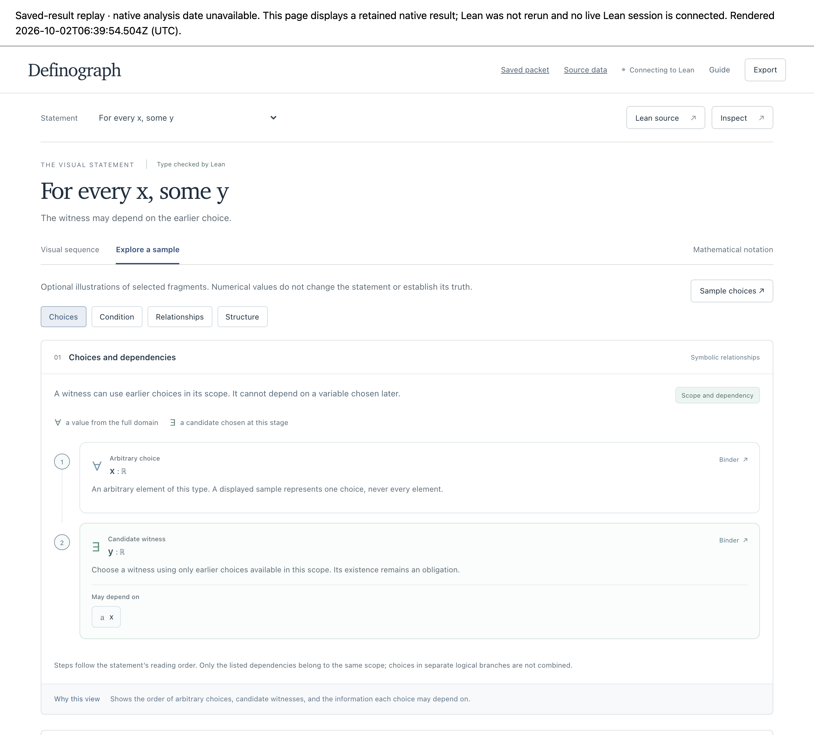

# Definograph

**Definograph draws the logical structure of a Lean 4 statement: what is chosen, in what order, under which assumptions, and what must hold.** It is for checking that a statement says what was meant. It reads statements, not proofs.

Research prototype. Lean 4.28.0 only. Runs locally; the full setup has been exercised on macOS arm64. The website shows recorded examples and runs no Lean.

[Recorded examples](https://definograph.com/examples/) (no install) · [Tutorial](https://definograph.com/learn/) · [Principles](docs/principles.md) · [Status](docs/status.md) · [Contributing](CONTRIBUTING.md)

## How it reads a statement

`∀ x, ∃ y, x < y` is drawn as a box inside a rail: `y` is chosen after `x` and may depend on it. `∃ y, ∀ x, x < y` is a rail inside a box: one `y` serves every `x`.

That drawing of the whole statement, the skeleton, comes first; below it the reader takes the quantifiers, assumptions and conclusions one step at a time. It reads Lean's elaborated term, so it shows what the source text hides. A part it cannot interpret stays on screen as plain structure, and it never supplies a witness or a proof. Selecting an object highlights its occurrences. In VS Code you can [inspect a definition](docs/editor-definition-exposure.md#inspect-from-the-statement) with its actual arguments and scope and return to the same step. Numerical examples, where supported, are kept apart from what the statement asserts. The [reading guide](docs/guided-reading.md) has the details.



*Recorded Choices view of `∀ x : ℝ, ∃ y : ℝ, x < y`: `y` may depend on the earlier `x`; its existence remains an obligation. [Exact Lean source](website/source-assets/views/web-light-captures-20261002/light-depends-app-context/source.lean). Rendered on 2 October 2026 from retained Lean 4.28.0 results, before the statement skeleton was added above the steps. Lean was not rerun; the original native acquisition date is unavailable.*

## What is proved, what is checked, what is only tested

Lean's kernel accepting a statement as well typed does not prove the statement, and nothing yet certifies the drawing. The [principles](docs/principles.md) give the standard; this is where the code stands.

| Claim | How it is established |
| --- | --- |
| The statement being read is well typed, and so is each definition the reader opens and each record field it projects | Lean's kernel at run time: `checkWithKernel` in the browser worker and in the editor's guided reading. The editor's **Source data** checks hand each declaration to the kernel under a resource bound |
| An opened definition is definitionally equal to what it replaces | In the guided reading, Lean's elaborator (`Meta.isDefEq`), not the kernel. In the editor's **Expose definition head**, a kernel-checked declaration |
| Every admitted Lean expression has a view that decodes back to it, and every view has a shared graph | Proved in Lean (`admitted_view_coverage`, `every_view_has_graph` in [`vendor/DefinographCapture`](vendor/DefinographCapture/README.md)). That code is linked only into the editor's context program; the guided reading does not run on it, and nothing is proved from the graph to the picture |
| The proved core declares no axiom and uses none outside `propext`, `Quot.sound` and `Classical.choice`; its theorems use only `propext` and `Quot.sound`, apart from listed theorems whose statements already depend on `Classical.choice`; its compiled modules replay through the kernel | `npm run test:axioms`, against [`scripts/axiom-policy.json`](scripts/axiom-policy.json). It needs the built native engine and is not run in CI |
| A drawing reads back to the structure it was drawn from | The statement skeleton: unit and native tests, not checked at run time. The structural drawings of **Source data** and of the saved-packet reader: read back and compared with their input before they are shown. The other guided figures: no readback |
| The axioms a selected term depends on | Recorded with each editor check and listed; not yet classified as clean or not. The browser path records none |
| The rest of the drawing, and the code that carries the kernel's verdict to the screen | Tested TypeScript; not proved |
| The drawing helps a reader | Not measured yet |

## Try it

**Without installing anything:** the [recorded examples](https://definograph.com/examples/) and the [tutorial](https://definograph.com/learn/) show the reader's own drawings with the exact Lean source beside each. They were recorded on 2 October 2026, before the skeleton.

**Locally:** you need **Node.js 22.12+** and an existing **Lean 4.28.0** executable. With `--download`, setup fetches the pinned mathlib's dependencies into the ignored `.local/` directory, which can use several GB. Retained setup evidence covers macOS arm64 with Node.js 24.18.1. Linux, WSL and minimum-version compatibility remain unqualified; native Windows linking is not implemented.

```sh
git clone https://github.com/N-Y-L/definograph.git
cd definograph
npm ci --ignore-scripts
npm run setup:lean -- \
  --lean /absolute/path/to/lean-4.28.0/bin/lean \
  --download
npm run dev
```

Open [localhost:5173](http://127.0.0.1:5173), choose a statement, and follow **Next**, or enter a statement term such as `∀ x : ℝ, ∃ y : ℝ, x < y`. **Lean source** accepts a statement term, not a file of declarations. For a production build, run `npm run build` followed by `npm start`, then open [localhost:4317](http://127.0.0.1:4317).

Setup pins mathlib to `8f9d9cff6bd728b17a24e163c9402775d9e6a365`. Instead of `--download`, pass `--packages /absolute/path/to/a/built/.lake/packages` for an existing matching cache. Setup does not install Lean or change Elan defaults. See the [setup contract](docs/lean-contract.md) and [installation qualification](docs/editor-integration.md#installation-qualification).

### Use VS Code

The companion reads a selection in your own trusted Lean 4.28.0 project, against that project's built imports. Install the official Lean extension (`leanprover.lean4`) in VS Code **1.95+**. After `npm run setup:lean` and `npm run build` above, run:

```sh
npm ci --prefix extension --ignore-scripts
node --import tsx scripts/verify-local-setup.ts
npm run package --prefix extension -- --out /absolute/path/to/new/statement-lens-editor-0.7.1.vsix
```

Install the file with **Extensions: Install from VSIX…**, set `statementLens.engineDirectory` in VS Code **User settings** to this checkout's absolute path, select a proposition or a proof, and run **Definograph: Visualize Selection**. Editor mode re-elaborates the whole active buffer, so Lean commands in it can run code; it is not a security sandbox. The [editor guide](docs/editor-integration.md) covers packaging, the supported journeys, the trust model and the failure states.

## Architecture and boundaries

```text
Lean term or trusted editor buffer
  → elaborated expressions, context and recorded checks
  → scoped structure and supported mathematical interpretations
  → guided reading, diagrams and explicit interpretation gaps
```

The standalone reader, editor inspections, saved packets and raw source-data view have different contracts. The [reader relation table](docs/reader-relations.md) and [documentation map](docs/README.md) explain their scope. Imported snapshots remain unverified records; a stored outcome does not certify the current source. Analysis runs locally without a model API or cloud service; see the [execution boundaries](docs/editor-integration.md#execution-and-isolation-limits).

The [architecture decision](docs/design/architecture-decision.md) and [roadmap](docs/roadmap.md) describe the compositional engine still to be completed. Their acceptance gates are research goals, not established universal coverage. The [code map](docs/architecture.md) describes the implementation.

## Develop

The invariants a change must keep, the exact checks CI runs, the native checks and the commit rules are in the [agent guide](AGENTS.md#checks); [CONTRIBUTING.md](CONTRIBUTING.md) says which contributions help. The public website has a separate, reproducible build in [website/README.md](website/README.md).

## License and credits

The application is available under [Apache License 2.0](LICENSE); reused dependencies retain their own terms in [NOTICE](NOTICE). The [source-capture snapshot](vendor/DefinographCapture/README.md) is a pinned copy of this project's own foundation, a separate repository that is not public; its manifest records the commit and file hashes it was copied from. The snapshot is licensed under the Apache License 2.0 as well (its own [LICENSE](vendor/DefinographCapture/LICENSE)).

The 0.7 prototype was developed by Codex. The architecture decision and further development are by Claude. Both worked under the supervision of Neil Yuanting Li.

[Lean](https://github.com/leanprover/lean4) and [mathlib](https://github.com/leanprover-community/mathlib4) provide the formal environment. [LeanTeX](https://github.com/kmill/LeanTeX), KaTeX, CodeMirror and React support the interface. Exact reuse and attribution are recorded in [NOTICE](NOTICE); citation metadata is in [CITATION.cff](CITATION.cff).
